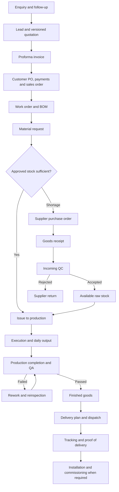

# Cryo Enterprise 2.0 — workflow and feature-change guide

Source baseline: `a4` at `5640b7e`, reviewed 19 November 2026. This is a map of the current checkout for developers and AI agents. The project rules live in [AI_INSTRUCTIONS.md](../AI_INSTRUCTIONS.md). The [business rules](business-logic.md) and [workflow specification](workflows.md) describe intended behavior. The [change history](../lk.md) explains how the screens were consolidated.

| If the task is to… | Start here |
|---|---|
| Understand how a customer order becomes a delivered machine | [Follow one order](#follow-one-order) |
| Rename, move, merge, or split tabs | [Screen and tab map](#screen-and-tab-map) |
| Change a field, status, quantity, or relationship | [Data model dictionary](#data-model-dictionary) |
| Trace a button to an HTTP endpoint and server function | [Runtime architecture](#runtime-architecture) and [API and handler index](#api-and-handler-index) |
| Fix a handoff or change business behavior | [Known implementation differences](#known-implementation-differences) and [Feature-change playbook](#feature-change-playbook) |
| Run the project and verify a change | [Running and verifying changes](#running-and-verifying-changes) |

## Follow one order

Sales creates demand for a **finished product**. Production converts that demand into a **work order** and asks the Store for **raw materials**. Purchasing fills raw-material shortages. Logistics ships the resulting **finished goods** to the customer. HR maintains people and permissions across the five suites. The README groups these capabilities into 47 functional modules. The current UI exposes 32 sidebar entries, and several open different tabs of the same React component.



The diagram follows the intended quality-controlled path. The Store shortage screen and Daily Production screen also have direct stock-writing paths in this checkout. Their effects are documented below.

### 1. Sales and commercial handoff

1. **Capture demand.** Select a product, record the enquiry, and link or create the customer. Enquiry creation can also log the first follow-up and create a qualified lead. A later conversion action is available for an existing enquiry. Follow-ups carry customer, enquiry, lead, or quotation references.
2. **Negotiate.** A quotation holds product lines, quantities, prices, discounts, and GST. Revising it creates another document with the same quotation number and a new version. The previous record's status becomes `Negotiation`. Accepting or rejecting a quote updates its linked lead to `Won` or `Lost`.
3. **Record commercial documents.** A proforma invoice (PI) copies quotation items and totals. A customer purchase order records the buyer's PO and its verification. A payment references the PI. Recording the payment updates the received amount and balance immediately. Verification is a separate action.
4. **Hand over the sales order (SO).** The SO stores order items, commercial references, shipping details, and two status fields. Sending it to Production sets `status = In Production` and `productionStatus = Sent to Production`. The UI opens Production Orders. Creating the work order (WO) is a subsequent action. The handoff handler does not check PO verification or minimum advance.

A supplier PO orders inputs for the factory. A customer PO is the customer's authorization to buy a finished product. They belong to different suites, models, and endpoints. [Sales controller](../server/controllers/salesController.js) · [Orders and payments screen](../client/src/components/sales/OrdersPaymentsPage.jsx)

### 2. Raw materials, purchasing, inward QC, and returns

1. **Set up the Store.** Creating a material initializes its inventory row with zero available stock. Link suppliers to the material with price, minimum order quantity, and lead time. The supplier/material pair has a unique compound index.
2. **Order and receive.** A supplier PO carries material lines. A goods receipt note (GRN) records the quantities received, batch details, and the underlying PO. Receiving updates PO line received quantities and moves the PO to `Partially Received` or `Completed`. A standard receipt starts in `QC Pending`.
3. **Inspect.** QC checks that tested quantity equals accepted plus rejected. The accepted amount increments `Inventory.availableStock` and writes a `QC Inward Receipt` to `StockLedger`. The test retains `availableRejectedQuantity` for supplier returns. The current handler marks the GRN completed after a test, which matters for multi-line receipts.
4. **Return rejects.** A supplier return references the QC test and reduces its remaining rejected quantity. The current handler writes a return document and debit-note number. It does not deduct the same rejected quantity from approved stock.
5. **Monitor balances.** Stock and reports read inventory, ledger movements, thresholds, supplier pricing, and issue data. The materials listing adds a derived `currentStock` to its API response from `Inventory.availableStock`. The `Material` schema itself has no persisted `currentStock` field.

[SCM controller](../server/controllers/scmController.js) · [Incoming QC screen](../client/src/components/modules/QualityInventoryPage.jsx) · [Inventory schema](../server/models/Inventory.js)

### 3. Work order, bill of materials, and Store issue

1. **Plan the order.** Production Orders accepts a handed-over SO or a direct factory order. The WO carries product, quantity, dates, manager, and optional BOM. A bill of materials (BOM) is a versioned product recipe with raw material per unit. Creating a BOM links it to existing WOs for that product that lack a BOM. A schedule has its own shift, dates, activities, and supervisor.
2. **Request components.** The consolidated planning screen computes required quantity as quantity per unit × production quantity. It can request components during WO creation when a recipe exists, or from Planning & BOM later. A saved `MaterialRequest` moves the WO to `Waiting for Materials`.
3. **Issue what is available.** The Store compares remaining demand with approved stock. For 100 required and 60 available, issuing 60 should leave 40 outstanding. A partial issue updates the matching request lines and can put the WO in `Partially Issued`. Fully satisfying the request can advance the WO to `Ready to Start`.
4. **Fill shortages and finish the issue.** Store staff can prepare a PO for the shortage, receive it, then issue the balance. SCM and Production have separate issue endpoints and issue collections. Each handler attempts to mirror its issue document to the other collection. Both use the same raw inventory. A mirrored issue represents the same physical movement.

[Production order screen](../client/src/components/production/ProductionOrdersPage.jsx) · [Store screen](../client/src/components/modules/MaterialRequestsPage.jsx) · [Production controller](../server/controllers/productionController.js)

### 4. Assembly, QA, rework, and finished goods

- **Execution and output.** Starting an execution creates a running batch and updates the WO. Daily or weekly production updates add the submitted previous completed quantity to this period's completed quantity. Pending quantity is clamped at zero. Production progress can also change the linked SO's production status.
- **Formal completion.** A completion document starts at `QA Pending` and puts the WO `On Hold`. A production QA record holds measured parameters, tested/passed/failed quantities, result, and disposition. Failures or a rework decision can create a rework order. The repair record tracks corrective work and reinspection.
- **Warehouse admission.** The finished-goods screen records a serial number, approved quantity, WO, product, location, and optional QA reference. The separate daily-update path can also create an available finished good on completion. One finished-good record can carry multiple units under one serial field. Account for both fields when changing dispatch or traceability.

[Production tracking](../client/src/components/production/ProductionTrackingPage.jsx) · [Quality and rework](../client/src/components/production/QualityReworkPage.jsx) · [Finished goods](../server/models/FinishedGood.js)

### 5. Dispatch, delivery, and installation

1. **Plan and dispatch.** A delivery plan associates the SO, customer, product, intended quantity, transport method, and optional finished good. Dispatch records the exit slip. It updates linked plan/stock statuses, assigns transport, and creates the initial tracking milestone. The stock operation sets the linked finished-good record to `Dispatched`.
2. **Track and confirm.** Staff log locations, milestones, delays, and delivery exceptions. Proof of delivery (POD) records dispatched, received, and pending quantities. The confirmation can say `Partial Delivery` while its parent plan already says `Delivered`. The handler releases the assigned vehicle and can schedule installation based on the confirmation request.
3. **Commission on site.** Installation tracks the technician, site, serial number, schedule, and progress. The completion form covers mechanical fixing, electrical connection, power supply, sensor connection, temperature, software configuration, and overall operation. An explicit failure marks the certificate `Failed - Retest Required` and the parent job `Failed / Rework`. The schema defaults the seven items to `Pass`.

[Logistics controller](../server/controllers/logisticsController.js) · [Dispatch and transport](../client/src/components/logistics/DeliveryPlanningPage.jsx) · [Installation service](../client/src/components/logistics/InstallationServicePage.jsx)

### 6. Employees, permissions, and auditing

An employee references a department and a role. Staff actions include account creation, profile edits, password reset, and status changes. Login compares a bcrypt password hash and issues a JWT. The React app has handlers to store and clear the session in local storage. The current `employee-login` navigation alias renders the employee directory. Check component wiring before changing an existing login experience.

Roles have seven flags per permission area: `access`, `view`, `add`, `edit`, `delete`, `export`, and `approve`. The 13 areas are Dashboard, Marketing, Sales, Purchase, Production, Supply Chain, Inventory, Quality Assurance, Logistics, Installation, Employee Management, Reports, and Settings. The role-update handler clears actions when access is disabled and protects the Super Admin role. HR actions generate audit records. Only the current-user route mounts the authentication middleware in the registered routers. Permission configuration and server-side enforcement therefore need separate verification.

[Employee controller](../server/controllers/employeeController.js) · [Employee routes](../server/routes/employeeRoutes.js) · [Role schema](../server/models/Role.js)

## Runtime architecture

| Layer | Where a change enters | Behavior that links it to other layers |
|---|---|---|
| Browser shell | [main.jsx](../client/src/main.jsx), [App.jsx](../client/src/App.jsx) | React 19 SPA. `activeDomain` and `activeModule` select the screen in memory. Cross-screen selections such as GRN → QC and SO → WO are passed as state and props. A module ID identifies UI state, not a browser URL. |
| Navigation and layout | [Sidebar](../client/src/components/common/Sidebar.jsx), [Header](../client/src/components/common/Header.jsx), [CSS](../client/src/index.css) | The sidebar exports module arrays reused by the header. The app also has mobile bottom navigation and separate domain defaults. Current CSS uses a light enterprise theme. |
| Data loading and actions | [App.jsx](../client/src/App.jsx), [api.js](../client/src/services/api.js) | `loadAllData()` fetches all five suites in parallel on mount and after most mutations. Individual reads often fall back to empty arrays or null. Mutations are passed to pages as callbacks. Check their return values when the next form needs a newly created ID. |
| HTTP and persistence | [Vite config](../client/vite.config.js), [Express entry](../server/server.js), [DB config](../server/config/db.js) | Vite forwards `/api` from port 3000 to Express on port 5000. Express dispatches to five routers. Controllers read/write Mongoose documents, often across collections in sequence. MongoDB defaults to `cryo_scm`. |
| Reusable UI | [DataTable](../client/src/components/common/DataTable.jsx), [Modal](../client/src/components/common/Modal.jsx), [KpiCard](../client/src/components/common/KpiCard.jsx), [StatusBadge](../client/src/components/common/StatusBadge.jsx) | DataTable handles search, pagination, toolbar actions, and row/cell rendering. Modal supplies the shared dialog frame. Toasts live in App and the mobile drawer is part of Sidebar. Sales and Production each have a workflow stepper. |

**Trace a button.** Store & Material Issue → `MaterialRequestsPage` → `onSaveMaterialIssue` → `App.handleSaveMaterialIssue` → `api.createMaterialIssue` → `POST /api/material-issues` → `scmController.createMaterialIssue` → inventory and ledger, issue slip, linked request and WO, then attempted Production mirror → `loadAllData()`. The similarly named `POST /api/production/material-issues` executes a different controller.

## Screen and tab map

The **sidebar ID** is the value passed to `setActiveModule`. The **screen** is the JSX actually rendered by `App`. Use these names when moving a feature. A page may host several child modules with independent filters and dialogs.

### Supply Chain navigation

| Sidebar label | Sidebar ID | Screen | Tabs or actions |
|---|---|---|---|
| Dashboard | `scm-dashboard` | [ScmDashboardModule](../client/src/components/modules/ScmDashboardModule.jsx) | SCM summary and shortcuts to purchasing, quality, stock, and store issues. |
| Stock | `scm-inventory` | [InventoryModule](../client/src/components/modules/InventoryModule.jsx) | Available stock, per-material ledger, and audit adjustments. |
| Materials | `scm-materials` | [MaterialsPage](../client/src/components/modules/MaterialsPage.jsx) | Material master, supplier links, and prefilled supplier PO actions. |
| Suppliers | `scm-suppliers` | [SuppliersPage](../client/src/components/modules/SuppliersPage.jsx) | Supplier directory and supplier–material links. |
| Purchasing | `scm-purchasing` | [PurchasingPage](../client/src/components/modules/PurchasingPage.jsx) | Purchase orders and goods receipts (GRNs). |
| Quality Control | `scm-quality-inventory` | [QualityInventoryPage](../client/src/components/modules/QualityInventoryPage.jsx) | QC pending, QC history, and supplier returns. The sidebar opens history. |
| Store & Material Issue | `scm-material-issues` | [MaterialRequestsPage](../client/src/components/modules/MaterialRequestsPage.jsx) | Material requests, stock and material issue, purchase and GRN, and issue history. The sidebar opens the issue tab. |
| Reports | `scm-reports` | [ScmReportsPage](../client/src/components/modules/ScmReportsPage.jsx) | Inventory, purchasing, and shortages. |

### Sales navigation

| Sidebar label | Sidebar ID | Screen | Tabs or actions |
|---|---|---|---|
| Dashboard | `sales-dashboard` | [DashboardModule](../client/src/components/sales/DashboardModule.jsx) | Sales KPIs and pipeline shortcuts. |
| Products | `sales-products` | [ProductsModule](../client/src/components/sales/ProductsModule.jsx) | All products and categories. |
| Enquiries | `sales-enquiries` | [EnquiriesModule](../client/src/components/sales/EnquiriesModule.jsx) | All, new, follow-up, qualified, and lost. Capture demand and qualify an enquiry. |
| Quotations | `sales-quotations` | [QuotationsModule](../client/src/components/sales/QuotationsModule.jsx) | All, draft, sent/under review, accepted, and rejected. Version and accept proposals. |
| Proforma Invoices | `sales-proforma-invoices` | [ProformaInvoicesModule](../client/src/components/sales/ProformaInvoicesModule.jsx) | All, draft, sent, and confirmed filters. The confirmed filter also includes partially paid and paid PIs. |
| Payments | `sales-payments` | [OrdersPaymentsPage](../client/src/components/sales/OrdersPaymentsPage.jsx) | Opens Payments inside the shared orders page. Paid and pending views. Customer PO and SO are sibling tabs. |
| Sales Orders | `sales-orders` | [OrdersPaymentsPage](../client/src/components/sales/OrdersPaymentsPage.jsx) | Opens Sales Orders inside the same page. Customer POs and Payments are sibling tabs. SO filters include confirmed, in process, and completed. |
| Reports | `sales-reports` | [SalesReportsModule](../client/src/components/sales/SalesReportsModule.jsx) | Enquiries, leads, quotations, sales orders, customers, and payments. |

### Production navigation

| Sidebar label | Sidebar ID | Screen | Tabs or actions |
|---|---|---|---|
| Production Orders | `production-orders` | [ProductionOrdersPage](../client/src/components/production/ProductionOrdersPage.jsx) | Opens Orders. Create a factory or SO-linked work order and select it for planning. |
| Planning & BOM | `production-planning` | [ProductionOrdersPage](../client/src/components/production/ProductionOrdersPage.jsx) | Opens Planning & BOM. Define the product recipe and request raw materials. |
| Daily Production | `production-daily` | [ProductionOrdersPage](../client/src/components/production/ProductionOrdersPage.jsx) | Opens Daily Production. Record daily output and complete a work order. |
| Completed Production | `production-completed` | [ProductionOrdersPage](../client/src/components/production/ProductionOrdersPage.jsx) | Opens Completed Production. Review completed orders and linked warehouse records. |
| Dashboard | `production-dashboard` | [ProductionDashboardModule](../client/src/components/production/ProductionDashboardModule.jsx) | Production KPIs and shortcuts to production and Store workflows. |

### Logistics navigation

| Sidebar label | Sidebar ID | Screen | Tabs or actions |
|---|---|---|---|
| Dashboard | `logistics-dashboard` | [LogisticsDashboardModule](../client/src/components/logistics/LogisticsDashboardModule.jsx) | Fulfillment and installation KPIs. |
| Deliveries | `logistics-deliveries` | [DeliveryPlanningPage](../client/src/components/logistics/DeliveryPlanningPage.jsx) | Planning, dispatch, and vehicles/couriers in one page. |
| Tracking | `logistics-tracking` | [DispatchTrackingPage](../client/src/components/logistics/DispatchTrackingPage.jsx) | In transit, delivered, and exceptions. Log and filter shipment milestones. |
| Delivery Confirmation | `logistics-confirmation` | [DeliveryConfirmationModule](../client/src/components/logistics/DeliveryConfirmationModule.jsx) | Pending and confirmed deliveries. Record proof of delivery. |
| Installation & Service | `logistics-installation` | [InstallationServicePage](../client/src/components/logistics/InstallationServicePage.jsx) | Scheduled, in progress, completed, failed, and all jobs. The completion-checklist view is also addressable. |
| Reports | `logistics-reports` | [LogisticsReportsModule](../client/src/components/logistics/LogisticsReportsModule.jsx) | Deliveries, transit, and installations. |

### Employee Management navigation

| Sidebar label | Sidebar ID | Screen | Tabs or actions |
|---|---|---|---|
| Dashboard | `employee-dashboard` | [EmployeeDashboardModule](../client/src/components/employee/EmployeeDashboardModule.jsx) | Headcount, departments, roles, and recent activity. |
| Employees | `employee-directory` | [EmployeesPage](../client/src/components/employee/EmployeesPage.jsx) | All, active, and inactive employees. The directory hosts profile and account actions. |
| Departments | `employee-departments` | [DepartmentsModule](../client/src/components/employee/DepartmentsModule.jsx) | Department directory, creation, and head-of-department details. |
| Roles & Permissions | `employee-roles-permissions` | [RolesPermissionsModule](../client/src/components/employee/RolesPermissionsModule.jsx) | Roles and permissions matrix. |
| Audit Logs | `employee-audit-logs` | [AuditLogsPage](../client/src/components/employee/AuditLogsPage.jsx) | Audit and workforce report views. The report module also provides department analysis. |

### Secondary screens and compatible navigation IDs

These IDs also participate in App render conditions. Preserve them when changing sidebar labels, dashboard buttons, mobile navigation, or stepper callbacks. Sales has overlapping conditions: `sales-follow-ups` renders Enquiries and Follow-ups, and `sales-leads` renders Enquiries and Customers/Leads.

| Suite | Component reached | Additional IDs |
|---|---|---|
| Supply Chain | [InventoryModule](../client/src/components/modules/InventoryModule.jsx) | `scm-stock` |
| Supply Chain | [MaterialsPage](../client/src/components/modules/MaterialsPage.jsx) | `scm-material-master` |
| Supply Chain | [SuppliersPage](../client/src/components/modules/SuppliersPage.jsx) | `scm-supplier-links` |
| Supply Chain | [PurchasingPage](../client/src/components/modules/PurchasingPage.jsx) | `scm-purchase-orders`, `scm-grn` |
| Supply Chain | [QualityInventoryPage](../client/src/components/modules/QualityInventoryPage.jsx) | `scm-qc-tests`, `scm-supplier-returns` |
| Supply Chain | [MaterialRequestsPage](../client/src/components/modules/MaterialRequestsPage.jsx) | `scm-material-requests` |
| Supply Chain | [ScmReportsPage](../client/src/components/modules/ScmReportsPage.jsx) | `scm-inventory-reports` |
| Sales | [EnquiriesModule](../client/src/components/sales/EnquiriesModule.jsx) | `sales-enquiry`, `sales-customers-enquiries`, `sales-follow-ups`, `sales-leads` |
| Sales | [FollowUpsModule](../client/src/components/sales/FollowUpsModule.jsx) | `sales-follow-ups`, `sales-followup` |
| Sales | [CustomersLeadsModule](../client/src/components/sales/CustomersLeadsModule.jsx) | `sales-leads`, `sales-customers-leads` |
| Sales | [QuotationsModule](../client/src/components/sales/QuotationsModule.jsx) | `sales-quotation`, `sales-quotations-pi` |
| Sales | [ProformaInvoicesModule](../client/src/components/sales/ProformaInvoicesModule.jsx) | `sales-pi` |
| Sales | [OrdersPaymentsPage](../client/src/components/sales/OrdersPaymentsPage.jsx) | `sales-so`, `sales-orders-payments`, `sales-customer-pos`, `sales-sales-orders` |
| Production | [ProductionOrdersPage](../client/src/components/production/ProductionOrdersPage.jsx) | `production-bom`, `production-schedule` |
| Production | [ProdMaterialRequestsPage](../client/src/components/production/ProdMaterialRequestsPage.jsx) | `production-materials`, `production-material-requests`, `production-material-issue` |
| Production | [ProductionTrackingPage](../client/src/components/production/ProductionTrackingPage.jsx) | `production-manufacturing`, `production-tracking`, `production-execution`, `production-updates`, `production-completion` |
| Production | [QualityReworkPage](../client/src/components/production/QualityReworkPage.jsx) | `production-quality`, `production-quality-rework`, `production-qa`, `production-rework` |
| Production | [FinishedGoodsModule](../client/src/components/production/FinishedGoodsModule.jsx) | `production-finished-goods` |
| Production | [ProductionReportsModule](../client/src/components/production/ProductionReportsModule.jsx) | `production-reports` |
| Logistics | [DeliveryPlanningPage](../client/src/components/logistics/DeliveryPlanningPage.jsx) | `logistics-planning`, `logistics-dispatch`, `logistics-vehicles-couriers` |
| Logistics | [DispatchTrackingPage](../client/src/components/logistics/DispatchTrackingPage.jsx) | `logistics-dispatch-tracking` |
| Logistics | [DeliveryConfirmationModule](../client/src/components/logistics/DeliveryConfirmationModule.jsx) | `logistics-pod` |
| Logistics | [InstallationServicePage](../client/src/components/logistics/InstallationServicePage.jsx) | `logistics-delivery-installation`, `logistics-installation-completion` |
| Employee Management | [EmployeesPage](../client/src/components/employee/EmployeesPage.jsx) | `employee-login`, `employees` |
| Employee Management | [RolesPermissionsModule](../client/src/components/employee/RolesPermissionsModule.jsx) | `employee-roles` |
| Employee Management | [AuditLogsPage](../client/src/components/employee/AuditLogsPage.jsx) | `employee-departments-reports`, `employee-reports` |

The [Sales stepper](../client/src/components/sales/SalesPipelineStepper.jsx) presents Enquiry → Quotation → Proforma Invoice → Sales Order. The [Production stepper](../client/src/components/production/ProductionPipelineStepper.jsx) presents Work Orders → Requisitions/Issues → Execution/Updates → QA/Rework → Finished Goods. Production also has the four-tab consolidated order page above. Secondary production pages retain request/issue tabs, execution/update/completion tabs, QA pending/passed/rework tabs, finished-goods stock filters, and production reports built from loaded records.

## Data model dictionary

MongoDB stores these records in **42 collections exposed by Mongoose models**. Collection names below come from Mongoose's model metadata. Each link opens the schema for required fields, defaults, line-item definitions, and indexes. The last column lists declared Mongoose references. Empty reference lists indicate a schema using scalar fields or embedded data.

### Supply Chain models

| Model / MongoDB collection | Purpose | Key fields | References |
|---|---|---|---|
| [Material](../server/models/Material.js) / `materials` | Raw material SKU and reorder thresholds | `materialCode`, `unit`, `minimumStock`, `reorderLevel` | — |
| [Supplier](../server/models/Supplier.js) / `suppliers` | Vendor identity and terms | `supplierCode`, `supplierName`, `paymentTerms` | — |
| [SupplierMaterialLink](../server/models/SupplierMaterialLink.js) / `suppliermateriallinks` | A supplier's contract for one material | `unitPrice`, `minOrderQty`, `leadTimeDays`, `preferredSupplier` | `supplier` → `Supplier`, `material` → `Material` |
| [PurchaseOrder](../server/models/PurchaseOrder.js) / `purchaseorders` | Outbound supplier PO and material lines | `poNumber`, `items`, `grandTotal`, `status` | `supplier` → `Supplier`, `items[].material` → `Material` |
| [GRN](../server/models/GRN.js) / `grns` | Inward PO receipt and received batches | `grnNumber`, `items`, `receivedDate`, `status` | `purchaseOrder` → `PurchaseOrder`, `supplier` → `Supplier`, `items[].material` → `Material` |
| [QCTest](../server/models/QCTest.js) / `qctests` | Incoming inspection and returnable rejects | `qcNumber`, `batchNumber`, `acceptedQuantity`, `rejectedQuantity`, `availableRejectedQuantity` | `grn` → `GRN`, `material` → `Material`, `supplier` → `Supplier` |
| [Inventory](../server/models/Inventory.js) / `inventories` | One stock balance per material | `availableStock`, `totalReceived`, `totalIssued`, `adjustments`, `minimumStock` | `material` → `Material` |
| [StockLedger](../server/models/StockLedger.js) / `stockledgers` | Quantity and balance after one stock movement | `transactionType`, `referenceDoc`, `qtyIn`, `qtyOut`, `balanceAfter` | `material` → `Material` |
| [MaterialIssue](../server/models/MaterialIssue.js) / `materialissues` | Store issue slip with text work order number | `issueNumber`, `workOrder`, `department`, `items` | `items[].material` → `Material` |
| [SupplierReturn](../server/models/SupplierReturn.js) / `supplierreturns` | Physical return and debit note | `returnNumber`, `returnQuantity`, `debitNoteNumber` | `supplier` → `Supplier`, `grn` → `GRN`, `qcReference` → `QCTest`, `material` → `Material` |

### Sales models

| Model / MongoDB collection | Purpose | Key fields | References |
|---|---|---|---|
| [Product](../server/models/Product.js) / `products` | Finished product catalog and selling price | `productCode`, `productName`, `standardPrice`, `modelNumber` | — |
| [Customer](../server/models/Customer.js) / `customers` | Buyer account with billing and shipping terms | `customerCode`, `companyName`, `billingAddress`, `shippingAddress` | — |
| [Enquiry](../server/models/Enquiry.js) / `enquiries` | Initial demand, quantity, and contact | `enquiryNumber`, `quantity`, `enquirySource`, `status` | `customer` → `Customer`, `product` → `Product` |
| [Lead](../server/models/Lead.js) / `leads` | Qualified opportunity and forecast | `leadNumber`, `expectedOrderValue`, `leadStatus` | `customer` → `Customer`, `enquiryReference` → `Enquiry`, `interestedProduct` → `Product` |
| [FollowUp](../server/models/FollowUp.js) / `followups` | Contact history and next action | `followUpNumber`, `contactMethod`, `nextFollowUpDate`, `nextAction` | `customer` → `Customer`, `enquiryReference` → `Enquiry`, `relatedLead` → `Lead`, `relatedQuotation` → `Quotation`, `quotationReference` → `Quotation` |
| [Quotation](../server/models/Quotation.js) / `quotations` | Commercial offer and revision history | `quotationNumber`, `version`, `items`, `grandTotal`, `previousVersion` | `customer` → `Customer`, `leadReference` → `Lead`, `items[].product` → `Product` |
| [ProformaInvoice](../server/models/ProformaInvoice.js) / `proformainvoices` | PI lines and advance/balance tracking | `piNumber`, `grandTotal`, `advanceAmount`, `totalReceived`, `balanceAmount` | `customer` → `Customer`, `quotation` → `Quotation`, `items[].product` → `Product` |
| [CustomerPO](../server/models/CustomerPO.js) / `customerpos` | Customer-issued PO and verification | `internalPOId`, `customerPONumber`, `poAmount`, `verifiedDate` | `customer` → `Customer`, `piReference` → `ProformaInvoice`, `quotationReference` → `Quotation` |
| [Payment](../server/models/Payment.js) / `payments` | Receipt and verification details | `paymentNumber`, `amountReceived`, `transactionReference`, `status` | `customer` → `Customer`, `piReference` → `ProformaInvoice`, `salesOrderReference` → `SalesOrder` |
| [SalesOrder](../server/models/SalesOrder.js) / `salesorders` | Executable order and production handoff | `soNumber`, `items`, `orderAmount`, `status`, `productionStatus` | `customer` → `Customer`, `customerPOReference` → `CustomerPO`, `quotationReference` → `Quotation`, `piReference` → `ProformaInvoice`, `items[].product` → `Product` |

### Production models

| Model / MongoDB collection | Purpose | Key fields | References |
|---|---|---|---|
| [WorkOrder](../server/models/WorkOrder.js) / `workorders` | Production quantity, dates, and readiness | `workOrderNumber`, `productionQuantity`, `plannedStartDate`, `status` | `salesOrder` → `SalesOrder`, `customer` → `Customer`, `product` → `Product`, `bom` → `BOM` |
| [BOM](../server/models/BOM.js) / `boms` | Versioned recipe of raw material per finished unit | `bomNumber`, `version`, `materials`, `status` | `product` → `Product`, `materials[].material` → `Material` |
| [ProductionSchedule](../server/models/ProductionSchedule.js) / `productionschedules` | Shift plan, timing, and activities | `scheduleNumber`, `startDate`, `endDate`, `shift`, `activities` | `workOrder` → `WorkOrder`, `product` → `Product` |
| [MaterialRequest](../server/models/MaterialRequest.js) / `materialrequests` | Line-by-line requisition to the Store | `requestNumber`, `workOrderNumber`, `items`, `status` | `workOrder` → `WorkOrder`, `product` → `Product`, `items[].material` → `Material` |
| [ProductionIssue](../server/models/ProductionIssue.js) / `productionissues` | Production copy of a Store issue | `issueNumber`, `requestNumber`, `workOrderNumber`, `items`, `status` | `materialRequest` → `MaterialRequest`, `workOrder` → `WorkOrder`, `items[].material` → `Material` |
| [ProductionExecution](../server/models/ProductionExecution.js) / `productionexecutions` | Shop floor run, workstation, and operator | `executionNumber`, `materialsIssued`, `machineWorkstation`, `status` | `workOrder` → `WorkOrder`, `product` → `Product` |
| [ProductionUpdate](../server/models/ProductionUpdate.js) / `productionupdates` | Period and cumulative production output | `updateNumber`, `completedQuantity`, `totalCompletedQuantity`, `pendingQuantity` | `workOrder` → `WorkOrder`, `product` → `Product` |
| [ProductionCompletion](../server/models/ProductionCompletion.js) / `productioncompletions` | Physical assembly sign-off | `completionNumber`, `producedQuantity`, `acceptedDuringProduction`, `status` | `workOrder` → `WorkOrder`, `product` → `Product` |
| [ProductionQA](../server/models/ProductionQA.js) / `productionqas` | Functional inspection and disposition | `qaNumber`, `testedQuantity`, `passedQuantity`, `failedQuantity`, `decision` | `workOrder` → `WorkOrder`, `completion` → `ProductionCompletion`, `product` → `Product` |
| [ReworkOrder](../server/models/ReworkOrder.js) / `reworkorders` | Repair and reinspection of defective units | `reworkNumber`, `reworkQuantity`, `repairAction`, `retestStatus` | `workOrder` → `WorkOrder`, `qaReference` → `ProductionQA`, `product` → `Product`, `reQAReference` → `ProductionQA` |
| [FinishedGood](../server/models/FinishedGood.js) / `finishedgoods` | Serialized stock, availability, and warehouse location | `fgNumber`, `serialNumber`, `approvedQuantity`, `stockStatus` | `workOrder` → `WorkOrder`, `salesOrder` → `SalesOrder`, `product` → `Product`, `qaApprovalReference` → `ProductionQA` |

### Logistics models

| Model / MongoDB collection | Purpose | Key fields | References |
|---|---|---|---|
| [DeliveryPlan](../server/models/DeliveryPlan.js) / `deliveryplans` | Customer delivery allocation and balance | `deliveryNumber`, `serialNumber`, `plannedDeliveryQuantity`, `pendingQuantity` | `salesOrder` → `SalesOrder`, `customer` → `Customer`, `product` → `Product`, `finishedGood` → `FinishedGood` |
| [VehicleCourier](../server/models/VehicleCourier.js) / `vehiclecouriers` | Fleet vehicle or courier and its assignment | `code`, `entityType`, `vehicleNumber`, `courierPartner`, `status` | `assignedDelivery` → `DeliveryPlan` |
| [Dispatch](../server/models/Dispatch.js) / `dispatches` | Warehouse exit slip and physical shipment | `dispatchNumber`, `serialNumber`, `actualDispatchQuantity`, `deliveryChallan` | `deliveryPlan` → `DeliveryPlan`, `salesOrder` → `SalesOrder`, `customer` → `Customer`, `product` → `Product`, `finishedGood` → `FinishedGood`, `vehicleCourier` → `VehicleCourier` |
| [DeliveryTracking](../server/models/DeliveryTracking.js) / `deliverytrackings` | Dated transit checkpoint | `trackingNumber`, `currentLocation`, `currentStatus`, `expectedArrival` | `deliveryPlan` → `DeliveryPlan`, `dispatch` → `Dispatch` |
| [DeliveryConfirmation](../server/models/DeliveryConfirmation.js) / `deliveryconfirmations` | Proof of delivery and balance for this receipt | `confirmationNumber`, `dispatchedQuantity`, `receivedQuantity`, `pendingQuantity` | `deliveryPlan` → `DeliveryPlan`, `dispatch` → `Dispatch`, `customer` → `Customer`, `product` → `Product` |
| [Installation](../server/models/Installation.js) / `installations` | Field assignment for a delivered serial | `installationNumber`, `serialNumber`, `assignedTechnician`, `status` | `deliveryPlan` → `DeliveryPlan`, `salesOrder` → `SalesOrder`, `customer` → `Customer`, `product` → `Product` |
| [InstallationCompletion](../server/models/InstallationCompletion.js) / `installationcompletions` | Commissioning certificate and customer acknowledgment | `completionNumber`, `overallResult`, `testingDetails`, `status` | `installation` → `Installation`, `customer` → `Customer`, `product` → `Product` |

### Employee Management models

| Model / MongoDB collection | Purpose | Key fields | References |
|---|---|---|---|
| [Department](../server/models/Department.js) / `departments` | Organizational unit and head count | `departmentCode`, `name`, `headOfDepartment`, `staffCount` | — |
| [Role](../server/models/Role.js) / `roles` | Permission matrix and protected-role marker | `name`, `isSuperAdmin`, `status` | — |
| [Employee](../server/models/Employee.js) / `employees` | Staff identity, account, and role assignment | `employeeId`, `username`, `departmentName`, `roleName`, `status` | `department` → `Department`, `role` → `Role` |
| [AuditLog](../server/models/AuditLog.js) / `auditlogs` | Recorded action and acting identity | `action`, `performedBy`, `performedByRole`, `target`, `timestamp` | — |

### Field meanings at suite boundaries

| Business concept | Stored representation | Implication for changes |
|---|---|---|
| Raw stock | `Inventory.availableStock` holds usable balance. Each `StockLedger` entry includes material, movement type, document number, quantity in/out, and resulting balance. | Compare an issue to both the balance and its ledger entry. Rejected stock awaiting return is tracked on the QC test. |
| Work order identity | `MaterialIssue.workOrder` is a text WO number. `ProductionIssue.workOrder` and `MaterialRequest.workOrder` are ObjectId references. They also carry display numbers. | Match the appropriate ID or number. Some API reads populate a reference into an object with `_id`, while forms can receive a raw ID. |
| Issue quantities | SCM uses `items[].issueQuantity`. Production uses `items[].issuedQty`. Request lines carry `requestedQty`, `requiredQty`, `alreadyIssuedQty`, and `remainingQty`. | Map each input once. Compare remaining quantities per material on partial and repeated issues. |
| Sales versus production status | `SalesOrder.status` describes the commercial order. `SalesOrder.productionStatus` tracks factory progress. `WorkOrder.status` describes an individual factory order. | A finished WO can leave the sales order `In Production` with `productionStatus = Completed`. Reports may use either field. |
| BOM version and order quantity | The work order stores a BOM reference. A product BOM stores its version and component ratios. The planning UI expands those ratios to material lines. | Editing a referenced BOM can affect the recipe seen later. Existing requisitions have their own line quantities. |
| Finished stock versus shipped quantity | `FinishedGood.serialNumber` and `approvedQuantity` identify a warehouse record. Dispatch stores `actualDispatchQuantity`. POD separately stores received and pending quantities. | A record-level dispatch status cannot by itself tell a report how many units actually arrived. |
| Human-readable numbers | Quotation revisions share a quotation number. Both a sales PI and a mirrored production issue can have a `PI-` prefix. | Use collection and reference IDs for joins. Include version for quotation selection and display. |

## Known implementation differences

These are source-level observations at the stated baseline. They matter when a change assumes that two screens or collections always agree.

| Area | Current behavior and consequence | Where to verify |
|---|---|---|
| Stock admission | Standard purchasing creates a quarantined GRN. Store shortage receiving sends `status: 'Accepted'`, and the server immediately posts a direct receipt. The audit-adjustment handler can also set a higher balance. Both diverge from the canonical QC-only admission rule. | [Store receipt form](../client/src/components/modules/MaterialRequestsPage.jsx), [SCM controller](../server/controllers/scmController.js), functions `createGRN`, `createQCTest`, `adjustStock`. |
| Multi-line GRN | Incoming QC displays the first line in the pending list. Creating a test for one material marks the whole GRN completed. For a GRN with two materials, check the second line's visibility and the total credited across inspections. | [QC page](../client/src/components/modules/QualityInventoryPage.jsx), [QC controller](../server/controllers/scmController.js). |
| Automatic WO → request handoff | The order form expects the created WO in the callback result. The App callback awaits creation and refresh, then returns no document. The next request can lack the required WO ID even though the WO already exists. Planning an existing WO also needs recipe lines, while the WO read only populates BOM number and version. | [Order page](../client/src/components/production/ProductionOrdersPage.jsx), [App callbacks](../client/src/App.jsx), [WO reads and request creation](../server/controllers/productionController.js). |
| Request's stock snapshot | Request creation reads `inv.currentStock`. The inventory schema uses `availableStock`. The stored request snapshot can therefore show zero while Store's live balance is positive. | [Request controller](../server/controllers/productionController.js), [inventory schema](../server/models/Inventory.js). |
| Production-side issue | Its handler saves the stock deduction, then writes a ledger entry with type `OUT` and fields `referenceNumber` and `currentStock`. The schema expects an allowed movement type, `referenceDoc`, and `balanceAfter`. Validation can fail after the deduction. A retry can deduct again. Both issue handlers also catch mirror-write errors separately from their primary operations. | Compare both `createMaterialIssue` implementations in [Production](../server/controllers/productionController.js) and [SCM](../server/controllers/scmController.js) with [StockLedger](../server/models/StockLedger.js). |
| Readiness and QA gates | Starting an execution writes `Running` without reading the request's issued balance. The daily-update path can create available FG before independent QA. Its completion lookup uses the WO ID. The formal FG creation handler separately accepts an optional QA reference. | [Production controller](../server/controllers/productionController.js), [FG schema](../server/models/FinishedGood.js). |
| Daily completion spans two API calls | The consolidated screen first saves a final daily update, which can close the WO and create FG. It then submits a separate completion using `completedQuantity`. The completion schema requires `producedQuantity`, `acceptedDuringProduction`, `actualStartDate`, and `productionSupervisor`. An error in the second call can leave the first call's writes in place. | [Daily completion action](../client/src/components/production/ProductionOrdersPage.jsx), [completion schema](../server/models/ProductionCompletion.js). |
| PI balance | PI creation initializes balance to total minus the required advance, even before recording a payment. Recording a payment recalculates balance from total minus actual receipts. Verification changes payment status separately. Compare these values when changing financial reports. | [Sales controller](../server/controllers/salesController.js), functions `createProformaInvoice`, `createPayment`, and `verifyPayment`. |
| Delivery and commissioning | A partial confirmation marks the plan delivered, sets already-delivered quantity to this receipt's quantity, and retains the pending amount. The plan schema has no partial-delivery status. Completion checks for an explicit fail and defaults missing checklist fields to pass. | [Logistics controller](../server/controllers/logisticsController.js), [delivery plan](../server/models/DeliveryPlan.js), [commissioning schema](../server/models/InstallationCompletion.js). |
| Access and audit attribution | A populated role matrix does not establish authorization for a business operation. Only `GET /api/employees/me` mounts `protect`. Several audit handlers fall back to a Super Admin label when caller identity is missing. | [Employee router](../server/routes/employeeRoutes.js), [auth middleware](../server/middleware/authMiddleware.js), [employee controller](../server/controllers/employeeController.js). |

## Feature-change playbook

| Requested change | Follow this path through the code | Check before calling it complete |
|---|---|---|
| Move or rename a tab | Find the sidebar ID in the screen map. Trace every App condition, `defaultTab`, dashboard shortcut, domain default, stepper alias, and mobile button that selects it. Rename the visible title separately from its internal ID when possible. | Open it from desktop, mobile, its dashboard, and the preceding workflow step. Check the intended sub-tab and any preselected record. |
| Add a field to a form or report | Start in the active page or its child module. Trace input → submit payload → App callback → API wrapper → controller mapping → schema → response projection → table/detail/export. | Create and reopen a record. Read an older record missing the new field. Compare its detail view and exported value. |
| Change a status or approval gate | Search the exact status across schemas, controllers, filters, KPIs, badges, and seed fixtures. Identify the transition that writes it and any parent or sibling it updates. | Exercise both allowed and blocked transitions. Verify the record, linked records, counts, and action buttons after refresh. |
| Change purchasing or issue logic | Trace both issue controllers, the two receiving UIs, and the inventory/ledger/request fields. Identify the single physical movement represented by mirrored documents. | For an issue of 60 against 100, check 60 deducted, 60 recorded once in the ledger, 40 outstanding, and matching status in both departments. Check a repeated submission and a failed multi-line issue in an isolated database. |
| Change production completion | Compare the daily completion action, formal completion, QA/rework, and FG admission. Decide where approved quantity, serial allocation, and sales-order progress are written. | Run a pass, a failure/rework, a partial batch, and a repeat completion. Compare the WO, completion, QA reference, FG quantity, and both sales-order status fields. |
| Change delivery, reporting, or permissions | Trace upstream records as well as display filters. For delivery, separate plan, dispatch, POD, and installation quantities. For a permission, trace the UI control, server middleware, and audit actor. | Compare a partial delivery with its parent plan and reports. For role changes, verify the permitted and denied cases with the appropriate identities in an isolated environment. |

**Example — move supplier links under Purchasing.** The supplier-contract editor is already implemented in `SupplierMaterialLinkModule`. Its current parent is `SuppliersPage`; the `scm-supplier-links` alias selects its Links tab. Material Master can navigate to that alias. Reuse the editor and pass the same supplier, material, and link callbacks from the new parent. Update the existing deep handoff so a user arriving from a material still reaches the correct editor. Verify duplicate supplier/material prevention and prefilled PO selection, which both consume these mappings. [Current parent](../client/src/components/modules/SuppliersPage.jsx) · [Existing editor](../client/src/components/modules/SupplierMaterialLinkModule.jsx) · [Compound index](../server/models/SupplierMaterialLink.js)

**Example — change shortage receiving to require QC.** Start with the Store shortage form, standard GRN form, and `createGRN`. Follow the accepted amount into `createQCTest`, inventory, ledger, and Store availability. For a receipt of 40 with 35 accepted and 5 rejected, the canonical workflow leaves the available balance unchanged on receipt, credits 35 once after inspection, and leaves 5 returnable. A request still needing 40 can now receive 35, with 5 outstanding. This scenario distinguishes received, approved, rejected, issued, and pending quantities across the full workflow. [Project rules](../AI_INSTRUCTIONS.md) · [Standard GRN form](../client/src/components/modules/GRNModule.jsx) · [Store form](../client/src/components/modules/MaterialRequestsPage.jsx)

### Locating callers quickly

Run these from the repository root. Replace the example ID, handler, or field with the subject of the change.

```powershell
rg -n --fixed-strings "scm-supplier-links" client/src
rg -n "createMaterialIssue|createProductionMaterialIssue|onSaveMaterialIssue" client/src server/routes server/controllers
rg -n "availableStock|alreadyIssuedQty|remainingQty" client/src server/controllers server/models
rg -n --fixed-strings "Ready to Start" client/src server/controllers server/models server/seed
```

## Running and verifying changes

- **Stack.** The client uses React, Vite, JavaScript/JSX, and custom CSS. The server uses Express and Mongoose with MongoDB. The client and server each have their own package manifest and lockfile. Read the [client scripts](../client/package.json), [server scripts](../server/package.json), and [project instructions](../AI_INSTRUCTIONS.md) before changing dependencies or implementation conventions.
- **Local development.** With dependencies installed, run `npm --prefix client run dev` from the root. For the backend, start in `server/` so dotenv resolves the server environment, then run `npm start` or `npm run dev`. The default browser address is `http://localhost:3000`. `GET http://localhost:5000/api/health` reports `200` for an active MongoDB connection or `503` when degraded. It checks connectivity, not business transactions.
- **Seed data.** [SCM](../server/seed/seedData.js), [Sales](../server/seed/salesSeed.js), [Production](../server/seed/productionSeed.js), [Logistics](../server/seed/logisticsSeed.js), and [Employees](../server/seed/employeeSeed.js) have separate seed scripts. Review each script's connection and clearing logic first. Several use `deleteMany({})`. Production references SCM/Sales records, and Logistics references Sales/finished goods, so seed those dependencies first when building a disposable demo dataset.
- **Build and lint.** Run `npm --prefix client run build` and `npm --prefix client run lint` for client changes. At the source-review baseline the build succeeded with a chunk-size warning and lint exited successfully with warnings. Neither package defines a test script, and no application tests were present in the client/server test directories at review time.
- **Workflow verification.** Use a disposable dataset for writes. Record document numbers, starting quantities, expected transitions, and resulting balances. Reopen each affected suite after refresh. A successful HTTP response checks only part of a multi-document handoff. For a documentation-only update, verify links, identifiers, route coverage, and the Git diff.

When a feature changes, update the affected screen rows, models, endpoint mappings, and workflow steps in this guide. Record which paths were exercised and refresh the source baseline after checking the new behavior.

## API and handler index

Read each row left to right to trace a request from the browser into Express. The path is relative to the **mount** in the heading. The client functions are methods of [api.js](../client/src/services/api.js). The server functions are exports of the linked controller. A dash indicates a registered route without a matching named wrapper in that file. The five routers register 121 method/path pairs before mount aliases. The separate `GET /api/health` route in [server.js](../server/server.js) serves `api.getHealth` and reports MongoDB connection state.

### Supply Chain API

Mount `/api` and `/api/scm`. [Router](../server/routes/scmRoutes.js) · [Controller](../server/controllers/scmController.js)

| Method | Path | Client method | Controller handler |
|---|---|---|---|
| GET | `/materials` | `getMaterials` | `getMaterials` |
| POST | `/materials` | `createMaterial` | `createMaterial` |
| PUT | `/materials/:id` | `updateMaterial` | `updateMaterial` |
| GET | `/suppliers` | `getSuppliers` | `getSuppliers` |
| POST | `/suppliers` | `createSupplier` | `createSupplier` |
| PUT | `/suppliers/:id` | `updateSupplier` | `updateSupplier` |
| GET | `/supplier-material-links` | `getSupplierMaterialLinks` | `getSupplierMaterialLinks` |
| POST | `/supplier-material-links` | `createSupplierMaterialLink` | `createSupplierMaterialLink` |
| PUT | `/supplier-material-links/:id` | `updateSupplierMaterialLink` | `updateSupplierMaterialLink` |
| GET | `/purchase-orders` | `getPurchaseOrders` | `getPurchaseOrders` |
| POST | `/purchase-orders` | `createPurchaseOrder` | `createPurchaseOrder` |
| PUT | `/purchase-orders/:id/status` | `updatePOStatus` | `updatePOStatus` |
| GET | `/grns` | `getGRNs` | `getGRNs` |
| POST | `/grns` | `createGRN` | `createGRN` |
| GET | `/qc-tests` | `getQCTests` | `getQCTests` |
| POST | `/qc-tests` | `createQCTest` | `createQCTest` |
| GET | `/inventory` | `getInventory` | `getInventory` |
| GET | `/inventory/ledger/:materialId` | `getMaterialLedger` | `getMaterialStockLedger` |
| POST | `/inventory/adjust` | `adjustStock` | `adjustStock` |
| GET | `/material-issues` | `getMaterialIssues` | `getMaterialIssues` |
| POST | `/material-issues` | `createMaterialIssue` | `createMaterialIssue` |
| GET | `/supplier-returns` | `getSupplierReturns` | `getSupplierReturns` |
| POST | `/supplier-returns` | `createSupplierReturn` | `createSupplierReturn` |
| GET | `/reports` | `getReports`, `getInventoryReport` | `getInventoryReport` |

### Sales API

Mount `/api/sales`. [Router](../server/routes/salesRoutes.js) · [Controller](../server/controllers/salesController.js)

| Method | Path | Client method | Controller handler |
|---|---|---|---|
| GET | `/products` | `getProducts` | `getProducts` |
| POST | `/products` | `createProduct` | `createProduct` |
| PUT | `/products/:id` | `updateProduct` | `updateProduct` |
| GET | `/dashboard-summary` | `getDashboardSummary` | `getDashboardSummary` |
| GET | `/enquiries` | `getEnquiries` | `getEnquiries` |
| POST | `/enquiries` | `createEnquiry` | `createEnquiry` |
| POST | `/enquiries/:id/convert-to-lead` | `convertEnquiryToLead` | `convertEnquiryToLead` |
| PUT | `/enquiries/:id/status` | `updateEnquiryStatus` | `updateEnquiryStatus` |
| GET | `/customers` | `getCustomers` | `getCustomers` |
| POST | `/customers` | `createCustomer` | `createCustomer` |
| GET | `/leads` | `getLeads` | `getLeads` |
| POST | `/leads` | `createLead` | `createLead` |
| PUT | `/leads/:id/status` | `updateLeadStatus` | `updateLeadStatus` |
| GET | `/follow-ups` | `getFollowUps` | `getFollowUps` |
| POST | `/follow-ups` | `createFollowUp` | `createFollowUp` |
| PUT | `/follow-ups/:id/status` | `updateFollowUpStatus` | `updateFollowUpStatus` |
| GET | `/quotations` | `getQuotations` | `getQuotations` |
| POST | `/quotations` | `createQuotation` | `createQuotation` |
| POST | `/quotations/:id/revise` | `reviseQuotation` | `reviseQuotation` |
| PUT | `/quotations/:id/status` | `updateQuotationStatus` | `updateQuotationStatus` |
| GET | `/proforma-invoices` | `getProformaInvoices` | `getProformaInvoices` |
| POST | `/proforma-invoices` | `createProformaInvoice` | `createProformaInvoice` |
| GET | `/customer-pos` | `getCustomerPOs` | `getCustomerPOs` |
| POST | `/customer-pos` | `createCustomerPO` | `createCustomerPO` |
| PUT | `/customer-pos/:id/verify` | `verifyCustomerPO` | `verifyCustomerPO` |
| GET | `/payments` | `getPayments` | `getPayments` |
| POST | `/payments` | `createPayment` | `createPayment` |
| PUT | `/payments/:id/verify` | `verifyPayment` | `verifyPayment` |
| GET | `/sales-orders` | `getSalesOrders` | `getSalesOrders` |
| POST | `/sales-orders` | `createSalesOrder` | `createSalesOrder` |
| GET | `/orders` | — | `getSalesOrders` |
| POST | `/orders` | — | `createSalesOrder` |
| POST | `/sales-orders/:id/send-to-production` | `sendSOToProduction` | `sendSOToProduction` |
| GET | `/sales-reports` | `getSalesReports` | `getSalesReports` |

### Production API

Mount `/api/production`. [Router](../server/routes/productionRoutes.js) · [Controller](../server/controllers/productionController.js)

| Method | Path | Client method | Controller handler |
|---|---|---|---|
| GET | `/dashboard-summary` | `getProductionDashboard` | `getProductionDashboard` |
| GET | `/work-orders` | `getWorkOrders` | `getWorkOrders` |
| POST | `/work-orders` | `createWorkOrder` | `createWorkOrder` |
| PUT | `/work-orders/:id/status` | `updateWorkOrderStatus` | `updateWorkOrderStatus` |
| GET | `/boms` | `getBOMs` | `getBOMs` |
| POST | `/boms` | `createBOM` | `createBOM` |
| PUT | `/boms/:id` | `updateBOM` | `updateBOM` |
| GET | `/schedules` | `getSchedules` | `getSchedules` |
| POST | `/schedules` | `createSchedule` | `createSchedule` |
| PUT | `/schedules/:id` | `updateSchedule` | `updateSchedule` |
| GET | `/material-requests` | `getMaterialRequests` | `getMaterialRequests` |
| POST | `/material-requests` | `createMaterialRequest` | `createMaterialRequest` |
| PUT | `/material-requests/:id/status` | `updateMaterialRequestStatus` | `updateMaterialRequestStatus` |
| GET | `/material-issues` | `getProductionMaterialIssues` | `getMaterialIssues` |
| POST | `/material-issues` | `createProductionMaterialIssue` | `createMaterialIssue` |
| GET | `/executions` | `getExecutions` | `getExecutions` |
| POST | `/executions` | `startExecution` | `startExecution` |
| PUT | `/executions/:id/status` | `updateExecutionStatus` | `updateExecutionStatus` |
| GET | `/production-updates` | `getProductionUpdates` | `getProductionUpdates` |
| POST | `/production-updates` | `createProductionUpdate` | `createProductionUpdate` |
| GET | `/completions` | `getCompletions` | `getCompletions` |
| POST | `/completions` | `createCompletion` | `createCompletion` |
| GET | `/qa-tests` | `getProductionQATests` | `getQATests` |
| POST | `/qa-tests` | `createProductionQATest` | `createQATest` |
| GET | `/rework-orders` | `getReworkOrders` | `getReworkOrders` |
| POST | `/rework-orders` | `createReworkOrder` | `createReworkOrder` |
| PUT | `/rework-orders/:id/status` | `updateReworkStatus` | `updateReworkStatus` |
| GET | `/finished-goods` | `getFinishedGoods` | `getFinishedGoods` |
| POST | `/finished-goods` | `createFinishedGood` | `createFinishedGood` |
| PUT | `/finished-goods/:id/status` | `updateFinishedGoodStatus` | `updateFinishedGoodStatus` |

### Logistics API

Mount `/api/logistics`. [Router](../server/routes/logisticsRoutes.js) · [Controller](../server/controllers/logisticsController.js)

| Method | Path | Client method | Controller handler |
|---|---|---|---|
| GET | `/dashboard` | `getLogisticsDashboard` | `getDashboardSummary` |
| GET | `/delivery-plans` | `getDeliveryPlans` | `getDeliveryPlans` |
| POST | `/delivery-plans` | `createDeliveryPlan` | `createDeliveryPlan` |
| GET | `/vehicles-couriers` | `getVehiclesCouriers` | `getVehiclesCouriers` |
| POST | `/vehicles-couriers` | `createVehicleCourier` | `createVehicleCourier` |
| PUT | `/vehicles-couriers/:id` | `updateVehicleCourier` | `updateVehicleCourier` |
| GET | `/dispatches` | `getDispatches` | `getDispatches` |
| POST | `/dispatches` | `createDispatch` | `createDispatch` |
| GET | `/tracking` | `getDeliveryTracking` | `getDeliveryTracking` |
| POST | `/tracking` | `createTrackingMilestone` | `updateTrackingMilestone` |
| GET | `/confirmations` | `getDeliveryConfirmations` | `getDeliveryConfirmations` |
| POST | `/confirmations` | `createDeliveryConfirmation` | `createDeliveryConfirmation` |
| GET | `/installations` | `getInstallations` | `getInstallations` |
| POST | `/installations` | `createInstallation` | `createInstallation` |
| PUT | `/installations/:id/status` | `updateInstallationStatus` | `updateInstallationStatus` |
| GET | `/installation-completions` | `getInstallationCompletions` | `getInstallationCompletions` |
| POST | `/installation-completions` | `createInstallationCompletion` | `createInstallationCompletion` |
| GET | `/reports` | `getLogisticsReports` | `getLogisticsReports` |

### Employee Management API

Mount `/api/employees`. [Router](../server/routes/employeeRoutes.js) · [Controller](../server/controllers/employeeController.js)

| Method | Path | Client method | Controller handler |
|---|---|---|---|
| POST | `/login` | `loginEmployee` | `login` |
| GET | `/me` | `getCurrentUser` | `getMe` |
| GET | `/dashboard` | `getEmployeeDashboard` | `getDashboardSummary` |
| GET | `/reports` | `getEmployeeReports` | `getReports` |
| GET | `/audit-logs` | `getAuditLogs` | `getAuditLogs` |
| GET | `/roles` | `getRoles` | `getRoles` |
| POST | `/roles` | `createRole` | `createRole` |
| PUT | `/roles/:id` | `updateRolePermissions` | `updateRolePermissions` |
| GET | `/departments` | `getDepartments` | `getDepartments` |
| POST | `/departments` | `createDepartment` | `createDepartment` |
| GET | `/` | `getEmployees` | `getEmployees` |
| POST | `/` | `createEmployee` | `createEmployee` |
| PUT | `/:id` | `updateEmployee` | `updateEmployee` |
| PUT | `/:id/reset-password` | `resetEmployeePassword` | `resetPassword` |
| PUT | `/:id/toggle-status` | `toggleEmployeeStatus` | `toggleEmployeeStatus` |
