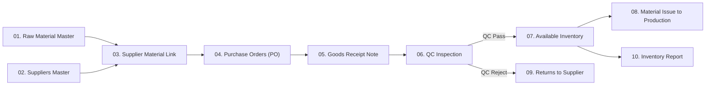
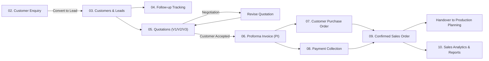
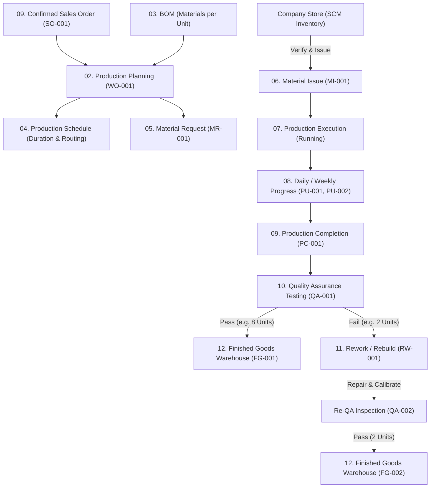

# Cryo Enterprise 2.0 – Complete Workflows Specification

This document details the complete end-to-end operational workflows for all three integrated modules: **Supply Chain Management**, **Sales Management**, and **Production Management**.

---

## 1. Supply Chain Management (SCM) Workflows

### SCM Workflow 1: Master Configuration
1. Define factory raw materials in **Raw Material Master** (`RM-001`, `RM-002`, etc.) with category, unit, minimum stock, and reorder levels.
2. Register vendor profiles in **Suppliers** (`SUP-001`) with GSTIN, contact person, payment terms, and address.
3. Establish supplier-material contracts in **Supplier Material Link** mapping vendor part code, rate per unit, minimum order quantity, and lead time. Compound indexing prevents duplicate mapping.

### SCM Workflow 2: Inward Procurement & Quality Loop
1. Create a **Purchase Order (PO)** selecting an active supplier and adding line items with unit price, tax %, and quantities.
2. Order Approval: `Draft` → `Submitted for Approval` → `Approved`.
3. Material Inward via **Goods Receipt Note (GRN)**: When shipment arrives at factory gates, store registers received quantity against PO lines.
4. **Quarantine Rule**: Creating a GRN sets items to `QC Pending`. Stock remains 0 in available inventory.
5. Quality Testing in **QC Tests**:
   - `Passed Qty`: Immediately credited to **Raw Material Inventory** and logged as `IN` transaction in Stock Ledger.
   - `Rejected Qty`: Transferred to **Returns to Supplier** queue for debit note generation.

### SCM Workflow 3: Material Consumption & Issue
1. Production shopfloor raises material requirement against a Work Order.
2. Store accesses **Material Issue** and confirms items.
3. System verifies `Issue Qty <= Available Approved Stock`.
4. Upon confirmation, inventory stock decreases and Stock Ledger logs an `OUT` transaction.

### SCM Workflow 4: Supplier Return & Debit Note
1. Initiated for items failing QC testing.
2. Store generates **Returns to Supplier** referencing the QC test, debit note number, and vehicle challan.
3. Rejected stock is closed and supplier balance adjusted.

---

## 2. Sales Management (CRM) Workflows

### Sales Workflow 1: Prospect Inward & Lead Conversion
1. Record prospective client requests in **Customer Enquiries** (`ENQ-001`).
2. Single-click **Save & Convert to Lead**:
   - Checks if customer company already exists. If yes, reuses the existing Customer Code (`CUS-001`). If new, automatically registers customer profile.
   - Creates a **Lead Opportunity** (`LD-001`) linked to the customer, product, and expected value without duplicate data entry.

### Sales Workflow 2: Commercial Quotation & Negotiation Versioning
1. Sales representative creates **Quotation** (`QT-001`) with multi-row line items (unit price, discount %, GST %) and commercial payment terms.
2. Initial status is `Sent` with Version `V1`.
3. Customer requests price reduction or modified specifications:
   - Rep clicks **Revise Quotation**.
   - System increments version (`V1` → `V2` → `V3`) while preserving historical records for commercial audit.
4. Acceptance:
   - When customer accepts quotation, status updates to `Accepted` and related Lead is automatically marked `Won`.
   - If customer cancels, marked `Rejected` / `Lost`.

### Sales Workflow 3: Proforma Invoice & Advance Remittance
1. Generate **Proforma Invoice (PI)** (`PI-001`) directly referencing accepted Quotation.
2. System auto-populates billing details, advance percentage required, and bank RTGS remittance details.
3. Customer submits formal **Customer Purchase Order (CPO)** (`CPO-001`). Accounts team verifies purchase order value against PI.
4. Client transfers advance funds, logged in **Payments** (`PAY-001`). Proforma invoice outstanding balance decrements automatically.

### Sales Workflow 4: Confirmed Sales Order & Production Handover
1. Once advance payment and customer PO are verified, **Sales Order** (`SO-001`) is issued.
2. Sales representative clicks **Send to Production**:
   - Sales Order status updates to `Production Ready`.
   - Work order parameters are immediately routed to the **Production Planning** department.

---

## 3. Production Management Workflows

### Production Workflow 1: Production Planning & BOM Locking
1. Production planner selects confirmed Sales Order (`SO-001`).
2. Creates **Work Order** (`WO-001`) for batch quantity (e.g. 10 Machines).
3. Connects to active **Bill of Materials (BOM)** (`BOM-001`):
   - Machine A unit formula: 10 Kg Steel Sheet + 1 Motor + 2 Sensors + 5m Wiring.
   - For 10 units: System calculates 100 Kg Steel Sheet, 10 Motors, 20 Sensors, 50m Wiring.
   - **BOM Lock Rule**: The BOM version attached to the Work Order is frozen to protect against silent specification tampering.

### Production Workflow 2: Schedule & Shift Allocation
1. Planner creates **Production Schedule** (`SCH-001`) defining planned start date (15-Nov) and target completion date (25-Nov).
2. Duration and working days are calculated automatically.
3. Allocates shift (Morning/Evening/Night), assigned supervisor, and milestone activities:
   - Cutting & Bending (2 Days)
   - Chassis Sub-Assembly (4 Days)
   - Motor & Sensor Wiring (2 Days)
   - Pre-Inspection Calibration (2 Days)

### Production Workflow 3: Material Requisition from Company Store
1. Shopfloor raises **Material Request** (`MR-001`) to the Company Store.
2. System pulls live available stock from the **Supply Chain inventory** database.
3. Work Order status updates to `Waiting for Materials`.

### Production Workflow 4: Store Verification & Physical Issue
1. Store Keeper reviews Material Request in **Material Issue**.
2. **Stock Gate**: Store keeper can only issue up to approved available stock (`Issued Qty <= Store Stock`).
3. Upon confirming issuance:
   - Central Store Inventory decrements immediately.
   - StockLedger records `OUT` transaction tagged with `MI-001` and batch numbers.
   - Work Order status advances to `Ready to Start`.

### Production Workflow 5: Manufacturing Execution & Shift Updates
1. Supervisor logs **Start Production** (`EX-001`) specifying workstation, operator crew, and calibration checklist. Work order transitions to `Running`.
2. Supervisors log daily progress in **Production Updates** (`PU-001`, `PU-002`):
   - Day 1: 5 units assembled (`PU-001`). Cumulative completed: 5 / 10 Units.
   - Day 2: 5 units assembled (`PU-002`). Cumulative completed: 10 / 10 Units.
   - Delay reasons, machine bottlenecks, and shift wastage are logged.

### Production Workflow 6: Production Completion & QA Handover
1. Once all 10 units are physically assembled, supervisor logs **Production Completion** (`PC-001`).
2. Remaining material scrap is reconciled back to the store.
3. Work order enters `QA Pending`.
4. **Finished Goods Exclusion Rule**: Physically completed units **cannot enter Finished Goods warehouse** until Quality Assurance tests and signs off working condition.

### Production Workflow 7: Quality Assurance (QA) Testing & Decision
1. Senior QA Engineer tests the completed batch in **Quality Assurance** (`QA-001`).
2. Parameters tested: Sensor Calibration, Heat/Thermal Load (<55°C), Motor Torque, Electrical Earth Insulation, Mechanical Operation.
3. Real-Time Result:
   - **8 Units Pass**: Thermal and sensor readings within 100% tolerance.
   - **2 Units Fail**: Thermal trip above 70°C and optical sensor misaligned.
4. Decision routing:
   - The 8 Passed units are admitted directly to **Finished Goods Warehouse** (`FG-001`).
   - The 2 Failed units are automatically routed to **Rework / Rebuild** (`RW-001`).

### Production Workflow 8: Closed-Loop Rework & Re-QA
1. Lead Service Technician opens **Rework Order** (`RW-001`).
2. Technician identifies dried thermal paste on heatsink and loose bracket screws.
3. Reapplies thermal compound, replaces fan jumper cable, and re-calibrates sensor bracket.
4. Technician bench-tests unit for 30 minutes at steady 48°C and marks `Repair Completed → Send for Re-QA`.
5. QA Inspector conducts **Re-QA Testing** (`QA-002`):
   - Thermal reading: 48.2°C (`Pass`).
   - Sensor tolerance: 0.005mm (`Pass`).
6. Both repaired units pass Re-QA and are received into **Finished Goods Warehouse** (`FG-002`).

### Production Workflow 9: Finished Goods Warehouse & Dispatch
1. Total order fulfillment achieved: **10 / 10 Machines** verified by QA and stored in Finished Goods Bay 4A.
2. Machines carry serialized tags (`MA-001` through `MA-010`) with warranty start dates.
3. Logistics changes stock status to `Reserved for Dispatch` and completes customer delivery.
