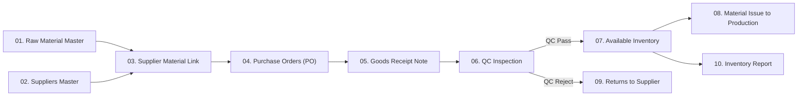
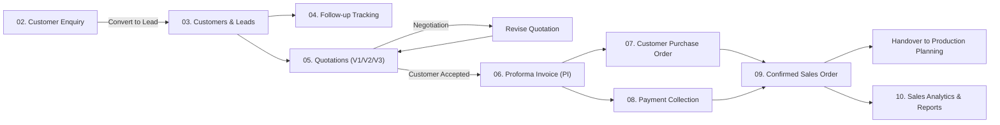
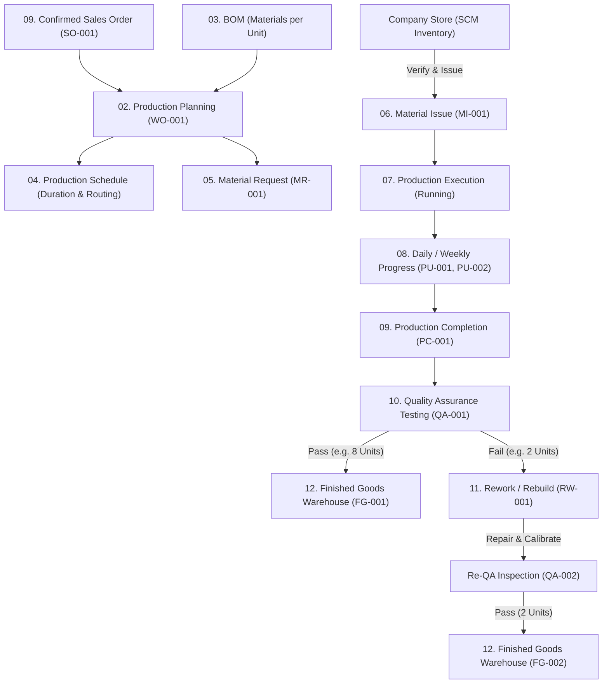
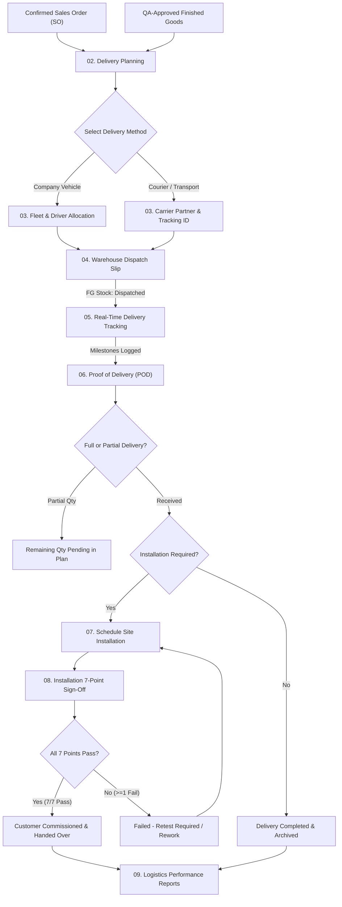

# Cryo Enterprise 2.0 – Complete Workflows Specification

This document details the complete end-to-end operational workflows for all three integrated modules: **Supply Chain Management**, **Sales Management**, and **Production Management**.

---

## 1. Supply Chain Management (SCM) Workflows



### SCM Workflow 1: Master Configuration
1. Define factory raw materials in **Raw Material Master** (`RM-001`, `RM-002`, etc.) with category, unit, minimum stock, and reorder levels.
2. Register vendor profiles in **Suppliers** (`SUP-001`) with GSTIN, contact person, payment terms, and address.
3. Establish supplier-material contracts in **Supplier Material Link** mapping vendor part code, rate per unit, minimum order quantity, and lead time. Compound indexing prevents duplicate mapping.

### SCM Workflow 2: Inward Procurement & Quality Loop
1. Create a **Purchase Order (PO)** selecting an active supplier and adding line items with unit price, tax %, and quantities.
2. Order Approval: `Draft` → `Submitted for Approval` → `Approved`.
3. Material Inward via **Goods Receipt Note (GRN)**: When shipment arrives at factory gates, store registers received quantity against PO lines.
4. **Quarantine Rule**: Creating a GRN sets items to `QC Pending`. Stock remains 0 in available inventory.
5. Quality Testing in **QC Tests**:
   - `Passed Qty`: Immediately credited to **Raw Material Inventory** and logged as `IN` transaction in Stock Ledger.
   - `Rejected Qty`: Transferred to **Returns to Supplier** queue for debit note generation.

### SCM Workflow 3: Material Consumption & Issue
1. Production shopfloor raises material requirement against a Work Order.
2. Store accesses **Material Issue** and confirms items.
3. System verifies `Issue Qty <= Available Approved Stock`.
4. Upon confirmation, inventory stock decreases and Stock Ledger logs an `OUT` transaction.

### SCM Workflow 4: Supplier Return & Debit Note
1. Initiated for items failing QC testing.
2. Store generates **Returns to Supplier** referencing the QC test, debit note number, and vehicle challan.
3. Rejected stock is closed and supplier balance adjusted.

---

## 2. Sales Management (CRM) Workflows



### Sales Workflow 1: Prospect Inward & Lead Conversion
1. Record prospective client requests in **Customer Enquiries** (`ENQ-001`).
2. Single-click **Save & Convert to Lead**:
   - Checks if customer company already exists. If yes, reuses the existing Customer Code (`CUS-001`). If new, automatically registers customer profile.
   - Creates a **Lead Opportunity** (`LD-001`) linked to the customer, product, and expected value without duplicate data entry.

### Sales Workflow 2: Commercial Quotation & Negotiation Versioning
1. Sales representative creates **Quotation** (`QT-001`) with multi-row line items (unit price, discount %, GST %) and commercial payment terms.
2. Initial status is `Sent` with Version `V1`.
3. Customer requests price reduction or modified specifications:
   - Rep clicks **Revise Quotation**.
   - System increments version (`V1` → `V2` → `V3`) while preserving historical records for commercial audit.
4. Acceptance:
   - When customer accepts quotation, status updates to `Accepted` and related Lead is automatically marked `Won`.
   - If customer cancels, marked `Rejected` / `Lost`.

### Sales Workflow 3: Proforma Invoice & Advance Remittance
1. Generate **Proforma Invoice (PI)** (`PI-001`) directly referencing accepted Quotation.
2. System auto-populates billing details, advance percentage required, and bank RTGS remittance details.
3. Customer submits formal **Customer Purchase Order (CPO)** (`CPO-001`). Accounts team verifies purchase order value against PI.
4. Client transfers advance funds, logged in **Payments** (`PAY-001`). Proforma invoice outstanding balance decrements automatically.

### Sales Workflow 4: Confirmed Sales Order & Production Handover
1. Once advance payment and customer PO are verified, **Sales Order** (`SO-001`) is issued.
2. Sales representative clicks **Send to Production**:
   - Sales Order status updates to `Production Ready`.
   - Work order parameters are immediately routed to the **Production Planning** department.

---

## 3. Production Management Workflows



### Production Workflow 1: Production Planning & BOM Locking
1. Production planner selects confirmed Sales Order (`SO-001`).
2. Creates **Work Order** (`WO-001`) for batch quantity (e.g. 10 Machines).
3. Connects to active **Bill of Materials (BOM)** (`BOM-001`):
   - Machine A unit formula: 10 Kg Steel Sheet + 1 Motor + 2 Sensors + 5m Wiring.
   - For 10 units: System calculates 100 Kg Steel Sheet, 10 Motors, 20 Sensors, 50m Wiring.
   - **BOM Lock Rule**: The BOM version attached to the Work Order is frozen to protect against silent specification tampering.

### Production Workflow 2: Schedule & Shift Allocation
1. Planner creates **Production Schedule** (`SCH-001`) defining planned start date (15-Nov) and target completion date (25-Nov).
2. Duration and working days are calculated automatically.
3. Allocates shift (Morning/Evening/Night), assigned supervisor, and milestone activities:
   - Cutting & Bending (2 Days)
   - Chassis Sub-Assembly (4 Days)
   - Motor & Sensor Wiring (2 Days)
   - Pre-Inspection Calibration (2 Days)

### Production Workflow 3: Material Requisition from Company Store
1. Shopfloor raises **Material Request** (`MR-001`) to the Company Store.
2. System pulls live available stock from the **Supply Chain inventory** database.
3. Work Order status updates to `Waiting for Materials`.

### Production Workflow 4: Store Verification & Physical Issue
1. Store Keeper reviews Material Request in **Material Issue**.
2. **Stock Gate**: Store keeper can only issue up to approved available stock (`Issued Qty <= Store Stock`).
3. Upon confirming issuance:
   - Central Store Inventory decrements immediately.
   - StockLedger records `OUT` transaction tagged with `MI-001` and batch numbers.
   - Work Order status advances to `Ready to Start`.

### Production Workflow 5: Manufacturing Execution & Shift Updates
1. Supervisor logs **Start Production** (`EX-001`) specifying workstation, operator crew, and calibration checklist. Work order transitions to `Running`.
2. Supervisors log daily progress in **Production Updates** (`PU-001`, `PU-002`):
   - Day 1: 5 units assembled (`PU-001`). Cumulative completed: 5 / 10 Units.
   - Day 2: 5 units assembled (`PU-002`). Cumulative completed: 10 / 10 Units.
   - Delay reasons, machine bottlenecks, and shift wastage are logged.

### Production Workflow 6: Production Completion & QA Handover
1. Once all 10 units are physically assembled, supervisor logs **Production Completion** (`PC-001`).
2. Remaining material scrap is reconciled back to the store.
3. Work order enters `QA Pending`.
4. **Finished Goods Exclusion Rule**: Physically completed units **cannot enter Finished Goods warehouse** until Quality Assurance tests and signs off working condition.

### Production Workflow 7: Quality Assurance (QA) Testing & Decision
1. Senior QA Engineer tests the completed batch in **Quality Assurance** (`QA-001`).
2. Parameters tested: Sensor Calibration, Heat/Thermal Load (<55°C), Motor Torque, Electrical Earth Insulation, Mechanical Operation.
3. Real-Time Result:
   - **8 Units Pass**: Thermal and sensor readings within 100% tolerance.
   - **2 Units Fail**: Thermal trip above 70°C and optical sensor misaligned.
4. Decision routing:
   - The 8 Passed units are admitted directly to **Finished Goods Warehouse** (`FG-001`).
   - The 2 Failed units are automatically routed to **Rework / Rebuild** (`RW-001`).

### Production Workflow 8: Closed-Loop Rework & Re-QA
1. Lead Service Technician opens **Rework Order** (`RW-001`).
2. Technician identifies dried thermal paste on heatsink and loose bracket screws.
3. Reapplies thermal compound, replaces fan jumper cable, and re-calibrates sensor bracket.
4. Technician bench-tests unit for 30 minutes at steady 48°C and marks `Repair Completed → Send for Re-QA`.
5. QA Inspector conducts **Re-QA Testing** (`QA-002`):
   - Thermal reading: 48.2°C (`Pass`).
   - Sensor tolerance: 0.005mm (`Pass`).
6. Both repaired units pass Re-QA and are received into **Finished Goods Warehouse** (`FG-002`).

### Production Workflow 9: Finished Goods Warehouse & Dispatch
1. Total order fulfillment achieved: **10 / 10 Machines** verified by QA and stored in Finished Goods Bay 4A.
2. Machines carry serialized tags (`MA-001` through `MA-010`) with warranty start dates.
3. Logistics changes stock status to `Reserved for Dispatch` and completes customer delivery.

---

## 4. Logistics & Delivery Management Workflows



### Logistics Workflow 1: Delivery Planning
1. Logistics manager monitors confirmed Sales Orders and QA-approved Finished Goods in warehouse.
2. Creates **Delivery Plan** (`DEL-001`):
   - Selects Sales Order reference (`SO-001`).
   - Customer details, shipping address, contact person, product, and quantities are auto-filled.
   - Calculates pending quantity balance for partial shipments.
   - Selects delivery method: **Company Vehicle** or **Courier / Transport**.
   - Indicates whether on-site installation and technician commissioning is required.

### Logistics Workflow 2: Transport Method & Asset Allocation
1. **Company Vehicle Flow**:
   - Assigns registered fleet vehicle (`TN-09-CB-4011`, Tata 407 LCV).
   - Assigns company driver (`K. Suresh`, DL: `TN0920180004123`).
   - Verifies vehicle fitness certificate, insurance validity, and GPS device ID.
2. **Courier / Third-Party Transport Flow**:
   - Assigns contracted logistics partner (e.g. VRL Logistics, Safechem Express, Blue Dart Surface).
   - Inputs tracking / LR / Docket number, dispatch hub, and carrier contact.

### Logistics Workflow 3: Warehouse Dispatch & Serial Number Allocation
1. Warehouse supervisor issues official **Dispatch Gate Slip** (`DISP-001`):
   - Matches physical finished goods serial number (`MB-001-SERIES-01`) to the delivery plan.
   - Verifies packaging, shock-indicator sticker, crate strapping, and manual book enclosure.
   - Generates e-Way bill number and tax invoice reference.
2. **Finished Goods Inventory Gate**:
   - The selected machine in `FinishedGoods` immediately updates `stockStatus: 'Dispatched'`.
   - Prevents double dispatch or phantom inventory allocation.

### Logistics Workflow 4: Real-Time Delivery Tracking
1. Logistics desk logs checkpoint milestones in **Delivery Tracking** (`TRK-001`):
   - Current checkpoint location (e.g. `Ambattur Industrial Hub`, `Sriperumbudur Tollway`, `Customer Factory Gate`).
   - Milestone status: `Dispatched` → `In Transit` → `Out for Delivery` → `Delivered`.
2. **Delay & Exception Logging**:
   - If route is hindered, flags `Delayed: true` with root-cause categorization (`Weather / Rain`, `Highway Traffic Jam`, `Vehicle Breakdown`, `Customer Site Gate Closed`).
   - Automatically computes revised estimated delivery date.

### Logistics Workflow 5: Proof of Delivery (POD) & Partial Acceptance
1. Delivery team arrives at customer facility and unloads equipment.
2. Generates **Delivery Confirmation / POD** (`POD-001`):
   - Records physical received quantity vs damaged quantity (if any).
   - Captures receiving representative name, mobile number, and condition of packaging (`Intact - Factory Sealed` vs `Tampered / Crushed`).
   - Customer digital signature acknowledgment recorded.
3. **Partial Delivery Engine**:
   - If only 2 of 3 units are accepted, `Delivered Qty` updates to 2, and `Pending Qty: 1` remains open in the Delivery Plan for subsequent fulfillment.
4. **Automated Installation Trigger**:
   - If `installationRequired: true`, confirming POD automatically initializes an **Installation Job** in `Scheduled` status.

### Logistics Workflow 6: On-Site Technical Installation
1. Lead Field Service Engineer (`Er. Rajesh Kumar`) is dispatched to customer cleanroom with calibrated tooling kit (Fluke thermal imager, torque wrench set, digital manometer, software configuration dongle).
2. Engineer inspects equipment unpacked at customer facility in **Installation** (`INS-001`).
3. Verifies power stability, grounding, chiller loop connections, and prepares commissioning run.

### Logistics Workflow 7: Mandatory 7-Point Installation Checklist & Sign-Off
1. Service engineer conducts the 7 mandatory safety and functional tests in **Installation Completion** (`ICOMP-001`):
   - `Checkpoint 1`: Machine Bed & Structural Base Fixed Properly (`Pass` / `Fail`)
   - `Checkpoint 2`: 3-Phase Electrical Wiring & Grounding Safe (`Pass` / `Fail`)
   - `Checkpoint 3`: Regulated Power Supply & Surge Protection Test (`Pass` / `Fail`)
   - `Checkpoint 4`: Cryo Sensor & Thermocouple Calibrations Verified (`Pass` / `Fail`)
   - `Checkpoint 5`: Operating Chamber Temperature Pulldown Test (`Pass` / `Fail`)
   - `Checkpoint 6`: Embedded Firmware & HMI Profile Setup Complete (`Pass` / `Fail`)
   - `Checkpoint 7`: Overall Functional Operation & Emergency Stop Test (`Pass` / `Fail`)
2. Itemizes live functional telemetry (e.g. 414.2V input voltage, -82.4°C pulldown temp, 2ms PLC ping).
3. **Strict Quality Gate**:
   - If all 7 checkpoints are `Pass` → Status marked `Completed`, customer signs handover note, warranty officially commences.
   - If even **one** checkpoint fails → System forces status to `Failed - Retest Required`. The job cannot be closed until a service technician rectifies the defect and passes all 7 points.

### Logistics Workflow 8: Logistics Intelligence & SLA Auditing
1. Management reviews **Logistics Reports**:
   - On-time delivery SLA percentage.
   - Fleet utilization and courier transit cost comparisons.
   - Transit delay root cause breakdown.
   - First-time installation pass rate vs retest rate.
   - Instant export to CSV and printable handover sheets.

---

## 5. Employee Management & Role-Based Access Control (RBAC) Workflows

```
Super Admin / HR Manager
       │
       ├─► 1. Define Departmental Hierarchy (Departments Master)
       │
       ├─► 2. Create RBAC Roles & Set 13-Module Permission Matrix
       │      ├─ Column 1: Access (Module Navigation)
       │      ├─ Column 2: View (Data Table Records)
       │      ├─ Column 3: Add (Create Dialog)
       │      ├─ Column 4: Edit (Update Record)
       │      ├─ Column 5: Delete (Archive/Remove)
       │      ├─ Column 6: Export (CSV/Excel Download)
       │      └─ Column 7: Approve (Financial / QC / Dispatch Sign-Off)
       │
       ├─► 3. Onboard Employee Profile
       │      └─ Assign ID, Department, Designation, Reporting Manager & Role
       │
       └─► 4. Employee Authentication & Session Control
              ├─ Bcrypt password hashing + JWT token verification
              ├─ Security audit trail recording every login, update, and deletion
              └─ Real-time instant role switching simulation for demo/testing
```

### Employee Workflow 1: Role Definition & Permission Matrix
1. Super Admin navigates to **Roles & Permissions**.
2. Selects an existing role (e.g. `Sales Executive`, `Production Manager`, `Store Keeper`, `QA Inspector`) or clicks **+ Add Custom Role**.
3. Configures the 13-Module permission matrix:
   - Module list: `Dashboard`, `Marketing`, `Sales`, `Purchase`, `Production`, `Supply Chain`, `Inventory`, `Quality Assurance`, `Logistics`, `Installation`, `Employee Management`, `Reports`, `Settings`.
   - Checks permission flags: `Access`, `View`, `Add`, `Edit`, `Delete`, `Export`, `Approve`.
   - **Security Rules**:
     - `Super Admin` role has immutable, universal access across all 13 modules (lock protection).
     - Disabling `Access` immediately clears and disables all 6 subsequent actions for that module.
     - Enabling any action automatically checks `Access` and `View`.
4. Saves permissions: Changes are immediately synced to MongoDB and logged to `AuditLog`.

### Employee Workflow 2: Staff Onboarding & Account Management
1. HR / Admin navigates to **Employees**.
2. Clicks **+ Add Employee**:
   - System auto-generates `Employee ID` (`EMP-007`).
   - Fills Staff Details: Name, Email, Contact Mobile, Department (dropdown), Designation, Role (dropdown), Reporting Manager, and initial Password.
3. Once created, employee record appears on the live staff table with Department badge and Role badge.
4. Quick actions:
   - **View Profile**: Inspect employee record, contact details, and assigned permissions.
   - **Reset Password**: Admin can set a temporary password without seeing the existing hashed password.
   - **Toggle Active / Inactive**: Deactivating an employee prevents future logins immediately.

### Employee Workflow 3: Multi-Account Authentication & Instant Role Switching
1. User navigates to **Employee Login**:
   - Active session card displays the currently logged-in user profile, avatar, department, and role badge.
   - Shows active permissions overview.
2. Quick Switcher allows instantaneous login simulation across 5 preconfigured organizational accounts:
   - `Super Admin` (`superadmin`) — Universal access across all 13 modules.
   - `Admin (Operations)` (`admin.operations`) — Operational supervision with approvals.
   - `Sales Executive` (`sales.kumar`) — Leads, quotes, enquiries.
   - `Store Manager` (`store.suresh`) — SCM, inventory, material issuance.
   - `QA Inspector` (`qa.kavitha`) — Quality assurance tests & rework sign-offs.
3. Manual credentials login also supported with JWT bearer token verification.

### Employee Workflow 4: Security Audit Trail & Workforce Intelligence
1. Executives navigate to **Employee Reports**:
   - **Workforce Roster**: Complete staff directory with department, role, contact info, and status.
   - **Security Audit Trail**: Real-time immutable event log tracking who logged in, created records, modified roles, or deleted items.
   - **Department Allocation**: Headcount distribution metrics by department.
2. One-click CSV export downloads structured audit and roster reports.
